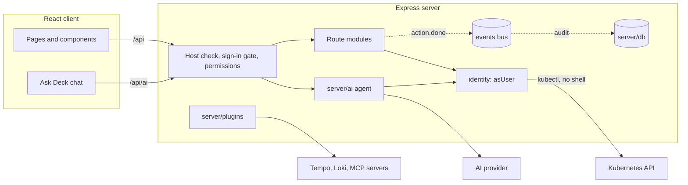

# Architecture

KubeDeck is one Node.js server that serves a React client and talks to clusters by running `kubectl`. The desktop app and web mode run the same server: the desktop is web mode in a box, with one local user who never signs in. This page explains the parts and the rules that hold them together.

## The big picture

## Two ways to run

| | Desktop | Web |
| --- | --- | --- |
| Shell | Electron (`electron/main.cjs`) loads the server bundle and opens a window on it | `node dist/index.cjs` in a container |
| Binds to | `127.0.0.1` | `0.0.0.0` |
| Who is asking | One local user, never signs in, an admin of their own KubeDeck | A signed-in person (Better Auth, in `server/auth`) |
| Clusters | The contexts in your kubeconfig files | Added by an admin in Settings → Clusters (`server/clusters`); no kubeconfig is read from disk |
| kubectl runs as | Your kubeconfig | The person's groups' service accounts on that cluster; none, no access |
| Database | `~/.kubedeck/kubedeck.db` by default: audit log, plugins, projects | SQLite file or Postgres: also accounts, sessions, clusters and groups |

In development, `npm run electron:dev` starts the server with `tsx` and points the window at it.

Web mode is a switch (`KUBEDECK_MODE=web`), not a fork. Code that only web mode needs (`server/auth`) is loaded with a dynamic import, so the desktop app never loads it.

## The server

`server/index.ts` builds one Express app. Every request passes the same gates, in order:

1. `/healthz` answers before anything else, for the pod's probes.
2. **Host and origin check** (`server/security.ts`): only the app's own hostnames and origin may call `/api`. On the desktop that blocks cross-site requests and DNS rebinding against the local server.
3. **Who is asking** (`webGate` in `server/web-mode.ts`): the desktop's local user, or the session's user in web mode. Without a session the API answers 401.
4. **Audit**: every write (`POST`, `PUT`, `PATCH`, `DELETE`) emits an `action.done` event when it finishes.
5. **Feature switches, KubeDeck permissions, read-only** (web mode): refuse what the server or the person's groups do not allow, with a message that says why.
6. **Parameter validation**: names, namespaces and contexts in routes are checked before they reach a kubectl argument.
7. **Identity binding**: the person's identity is put on the request's async context.

Then the route modules (`server/*-routes.ts`, mounted by `server/routes.ts`) do the work: resources, actions, details, logs, pod files, port-forward, map, traces, settings, the palette and the AI routes.

## kubectl as the person

KubeDeck has no Kubernetes client library. It runs `kubectl` with argument arrays, never through a shell (`server/kubectl-run.ts`: `spawnCommand`, `runKubectlRaw`).

Every spawn passes its arguments through `asUser()` from `server/identity.ts`, which adds the identity of the person making the request. In web mode, the cluster is the call's `--context`, and the identities are the service accounts of the person's groups on that cluster, in the groups' order:

- a service account impersonated through the cluster's connection: `--kubeconfig=<the cluster's file> --as=system:serviceaccount:<ns>:<name>`, or
- a group's uploaded kubeconfig: `--kubeconfig=<its file>`.

When the cluster answers Forbidden, the call is tried as the next identity. A refused request changed nothing, so retrying is safe.

Web mode reads no kubeconfig from disk: at start, `server/index.ts` points `KUBECONFIG` at an empty file, and every call names its connection with `--kubeconfig`. The connections live in `server/clusters` (Settings → Clusters), decrypted into private files at start. When none of the person's groups covers the cluster, or the call names no cluster, `spawnCommand` answers it with a refusal and kubectl never runs. Admins are no exception.

The identity rides on the request's `AsyncLocalStorage`, so it reaches kubectl calls deep inside route handlers and the assistant's tools without being passed around. A call outside a request has no person, so it gets no access: it fails closed. Only admin screens that check a connection itself run as KubeDeck (`asKubeDeck`), and they name the connection's file.

On the desktop, every call uses your kubeconfig.

## Modules with front doors

Bigger areas of the server are modules. Code outside a module imports only its `index.ts`:

| Module | What it owns |
| --- | --- |
| `server/auth` | Web mode's sign-in (the only code that knows Better Auth) and admin routes |
| `server/db` | The database connection and migrations |
| `server/audit` | The audit log (`audit_log` table) |
| `server/events` | The event bus |
| `server/plugins` | The plugin manager and Settings → Plugins routes (`plugin_state` table) |
| `server/observability` | The Tempo and Loki plugins |
| `server/mcp` | The MCP hub, the Grafana plugin and added MCP servers |
| `server/ai/tools` | The assistant's tool registry |
| `server/clusters` | Web mode's clusters and KubeDeck's connection to each, Settings → Clusters routes (`kubedeck_cluster`) |
| `server/groups` | Groups and their per-cluster access (`kubedeck_group`, `group_cluster_access`) |
| `server/projects` | Projects (`project` table) |

### Gateways

Only one module may load each outside library:

| Package | Only in |
| --- | --- |
| `better-auth` | `server/auth` |
| `kysely`, `pg`, `node:sqlite` | `server/db` |
| `@ai-sdk/mcp` | `server/mcp` |
| `ai` | `server/ai`, `client/src/ai` |
| `@ai-sdk/*` providers | `server/ai` |
| `@ai-sdk/react`, `@assistant-ui/*` | `client/src/ai` |

`tests/architecture.test.ts` checks these rules on every `npm test`. See [Code rules](/contributing/code-rules).

## The event bus

`server/events` lets a module say that something happened without calling the modules that care. The module that acts emits; the others subscribe.

| Event | Emitted when |
| --- | --- |
| `action.done` | A write through the API finished, with who made it |
| `user.changed` | An admin changed an account |
| `plugin.changed` | A plugin was switched, reconfigured, added or removed |
| `group.changed` | An admin created, changed, deleted or reordered a group |
| `cluster.changed` | An admin added, reconnected or removed a cluster |

`emit` never throws and never waits. Handlers run after the caller moves on, and a failing handler is logged without stopping the others. The audit module subscribes to `action.done` and writes the row. Events travel in memory.

## The database

`server/db` opens one Kysely connection, shared by Better Auth and KubeDeck's own tables:

- **SQLite** through Node's built-in `node:sqlite`, with no native add-on. The default, at `~/.kubedeck/kubedeck.db`. Run one replica with it.
- **Postgres** when `KUBEDECK_DATABASE_URL` starts with `postgres://`. Use it for several replicas.

KubeDeck's migrations live in `server/db/migrations.ts` and run on every start. Each table has one owning module; only that module reads or writes it. Better Auth's tables (`user`, `session`, `account`, `verification`) are touched only by Better Auth.

Web mode cannot start without its database. The desktop app keeps working without one, without its audit log, and keeps plugins and projects in memory for that run.

## Plugins and MCP

`server/plugins` knows every plugin, keeps each one's choices in `plugin_state`, and starts and stops them while KubeDeck runs. A plugin's settings come from the environment first, then what an admin saved, then defaults. Secret fields are encrypted at rest.

Built-in plugins: the Kubernetes tools, Tempo traces, Loki logs, Grafana (MCP) and the AI provider. Admins can add MCP servers by URL. The MCP hub in `server/mcp` is KubeDeck's only MCP client and connects to remote servers only. See [Plugins](/integrations/plugins) and [MCP servers](/integrations/mcp-servers).

## The assistant

`server/ai` holds the model providers, short one-shot tasks (diagnose, explain, summaries, command translation) and the Ask Deck agent, built on the AI SDK.

- Tools live in a **registry** (`server/ai/tools`). Each module calls `registerTools(owner, …)` with its tools, their risk and a per-call `forCall` that decides availability, descriptions and prompt sections. The agent only reads the registry.
- Commands the assistant runs are classified by `server/kubectl-safety.ts`: reads run, changes wait for the person's approval in the chat, and some verbs are always refused.
- The assistant's kubectl calls go through the same identity as the person's own clicks.
- Chat history lives in the client (IndexedDB). The server keeps none.

## The client

`client/src` is a React app built with Vite:

| Folder | What is there |
| --- | --- |
| `pages/` | One component per page: dashboard, resources, map, projects, traces, settings, sign-in |
| `components/` | Shared UI |
| `hooks/use-k8s.ts` | Data hooks for cluster data |
| `ai/` | The assistant: chat, inline AI actions |
| `lib/resource-kinds.ts` | The resource kinds in the sidebar |

`shared/` holds route definitions and schemas used by both sides. The client never imports `server/`, the server never imports `client/`, and `shared/` imports neither.

The documentation you are reading is built with docmd from `documentation/` into `dist/docs`, and the server serves it at `/docs`.

## Related

- [Code rules](/contributing/code-rules)
- [Security model](/web/security)
- [Desktop vs web](/web/overview)
