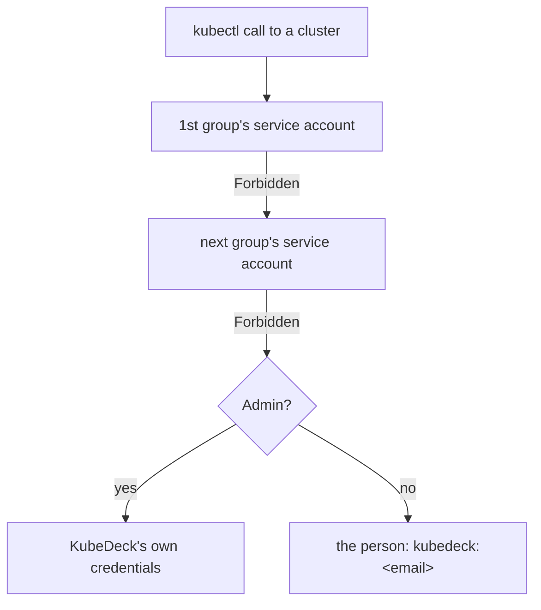

# Groups and cluster access

A group is a team, such as Developers or Quality team, that an admin defines in **Settings → Groups**. On each cluster an admin added in [Settings → Clusters](/web/clusters), a group can act as one service account. People in the group then run kubectl as that account there. A group is the only way anyone reaches a cluster, admins included. Groups also carry the [KubeDeck permissions](/web/permissions) that decide which features people may use.

Set up in this order: add the clusters, create groups with service accounts on them, then add people to the groups.

## Create a group

::: steps
::: step "Open Settings → Groups"
Only admins see it. Choose **New group**.
::: /step
::: step "Name it"
Give it a **Name** (up to 60 characters) and an optional **Description**. KubeDeck derives the group's id from the name: "Quality Team" becomes `quality-team`. The id never changes, and people's accounts carry it.
::: /step
::: step "Add cluster access"
Choose **Add a cluster**, pick one of the clusters from **Settings → Clusters**, and choose how the group signs in there: **Service account** or **Upload kubeconfig**. A group has one identity per cluster. With no clusters yet, the form links to **Settings → Clusters** instead.
::: /step
::: step "Set KubeDeck permissions"
Switch features on or off for the group. A new group starts with all of them on. See [Permissions](/web/permissions).
::: /step
::: step "Create it and add people"
Choose **Create group**. Add people from the group's **People** section, or from each person's panel in **Settings → Users**.
::: /step
::: /steps

## Two ways to sign in to a cluster

| | Service account | Upload kubeconfig |
|---|---|---|
| How it works | KubeDeck impersonates it through the cluster's connection: `--kubeconfig=<the cluster's connection> --as=system:serviceaccount:<namespace>:<name>`. | KubeDeck runs kubectl with the uploaded kubeconfig, not the cluster's connection. |
| You choose | A namespace and one of its service accounts, as the cluster's connection lists them. | A kubeconfig file, dropped, chosen or pasted. |
| Needs | The cluster's connection may `impersonate` that service account. | A token or an inline client certificate. |
| Use it when | The connection may impersonate on that cluster. | The connection may not impersonate there. |

### Service account

The form lists the cluster's namespaces and, for the one you pick, its service accounts, both read with the cluster's connection. It then checks whether the connection may impersonate the service account you named. It shows **KubeDeck can act as this service account.** when it may. Otherwise it says `KubeDeck may not impersonate service accounts in <namespace> on <cluster>.` and offers **Upload a kubeconfig instead**. If the connection may not list service accounts in that namespace, type the name.

To allow impersonation, see [What the connection needs](/web/clusters#clusters-what-the-connection-needs).

### Uploaded kubeconfig

KubeDeck accepts only credentials that cannot run anything on the server. It refuses a kubeconfig whose user has:

- an exec plugin, or an auth provider,
- a token file, or a client certificate or key given as file paths,
- a username and password,
- impersonation (`as`, `as-groups`, `as-uid`, `as-user-extra`).

It also refuses a cluster with a `certificate-authority` file path (use `certificate-authority-data`) or a `proxy-url`.

When the file has several contexts, KubeDeck uses the one named like the cluster, else the file's `current-context`. It keeps only that context's server, CA data, TLS settings, namespace and token or certificate.

On save, KubeDeck checks the credentials with `kubectl auth whoami`. If the cluster refuses them, the save fails. If the cluster cannot say who they are, the save still goes through. The group then shows whom the kubeconfig signs in as, and its server.

The kubeconfig is stored encrypted with a key derived from `KUBEDECK_AUTH_SECRET` and is never sent back to the browser. While KubeDeck runs, it is decrypted into a private temporary folder for kubectl to read.

::: callout warning title:"Changing KUBEDECK_AUTH_SECRET"
Stored kubeconfigs cannot be decrypted with a new secret. KubeDeck logs `Group <name>: the kubeconfig for <cluster> cannot be decrypted (was KUBEDECK_AUTH_SECRET changed?). Upload it again.` Calls with that group's access on that cluster fail until you do.
:::

## Which identity a call runs as

Every kubectl call goes to one cluster: its `--context`, which is the cluster's name in **Settings → Clusters**. A shared KubeDeck has no default cluster, so a call without one is refused: `pick a cluster: a shared KubeDeck has no default cluster.`

For the signed-in person, KubeDeck lines up only the service accounts of their groups that cover that cluster, in the order of the groups list. Each is either a service account impersonated through the cluster's connection, or a group's uploaded kubeconfig.

The call runs as the first. If the cluster answers Forbidden, KubeDeck runs it again as the next. A refused request changed nothing, so retrying is safe. If every identity is refused, you see the first refusal.

When none of their groups covers the cluster, there is nothing to try. KubeDeck refuses the call before kubectl runs: `none of your KubeDeck groups gives you access to cluster "<cluster>". Ask a KubeDeck admin.` This applies to admins too. KubeDeck's own connection is never used for a person's call, and nobody acts as themselves.

So permissions add up. A person may do whatever any of their service accounts on that cluster may do. The checks that hide buttons merge them the same way.

The scope switcher lists only the clusters the person's groups cover. With none, it says `No clusters for you yet. A KubeDeck admin gives your groups access to clusters.` An admin sees `No clusters for you yet. Add one under Settings → Clusters, then give a group of yours a service account on it.`

### Order matters only for which is tried first

The groups list is numbered. Hover a group and use the arrows to move it. The group detail says which place it has, for example "tried first". The **By cluster** view shows every group against every cluster in **Settings → Clusters**. Its last row, **Not covered**, is a reminder: where none of someone's groups has a service account, they have **no access**, admins included.

## Example

Three clusters added in **Settings → Clusters**, `dev`, `staging` and `prod`, and two groups:

| Group | `dev` | `staging` | `prod` |
|---|---|---|---|
| 1. Developers | `shop/shop-editor` (service account) | `shop/shop-viewer` (service account) | not covered |
| 2. On-call | not covered | uploaded kubeconfig, `ops/oncall` | uploaded kubeconfig, `ops/oncall` |

| Person | Groups | On `dev` | On `staging` | On `prod` |
|---|---|---|---|---|
| dana@example.com, user | Developers | `shop-editor` | `shop-viewer` | no access |
| sam@example.com, user | Developers, On-call | `shop-editor` | `shop-viewer`, then `ops/oncall` | `ops/oncall` |
| lee@example.com, admin | none | no access | no access | no access |
| kim@example.com, admin | On-call | no access | `ops/oncall` | `ops/oncall` |

Dana does not see `prod` in her scope switcher. Lee can manage clusters, groups and people, but sees no cluster until an admin, possibly Lee, adds Lee to a group.

## Group members and deleting

- A group's **People** section adds and takes people out. Changes apply on their next request.
- **Delete group** works only when nobody is in it. Otherwise it says `<group> still has <n> members. Remove them from the group first.`
- Groups that accounts already carry but nobody defined, for example from an older version, are defined on start, named after their id.

## Kubernetes permissions of a group

What a group's service account may do is set on the cluster, by its Roles, ClusterRoles and their bindings. KubeDeck does not change them. Each cluster row of a group has an **RBAC** menu that opens the service account, and the Roles and bindings around it, in KubeDeck's resource pages on that cluster. See [Permissions](/web/permissions#permissions-kubernetes-permissions).
