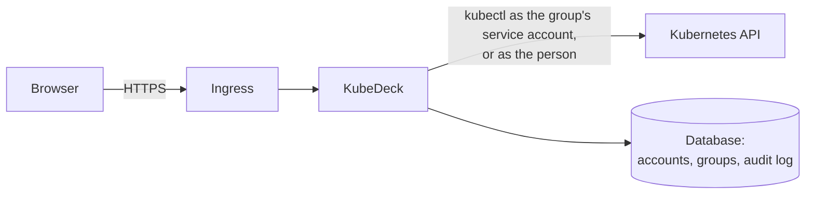

# Desktop vs web

KubeDeck is one server that runs in two modes. The **desktop** app is that server in an Electron window, using your own kubeconfig. **Web mode** runs the same server for a team: an admin adds the clusters, people sign in and belong to groups, and each kubectl call runs as the service accounts their groups have on that cluster.

Web mode is on when the server starts with `KUBEDECK_MODE=web`. The published Docker image sets it for you.

## How a request flows in web mode



The cluster's RBAC decides every request. KubeDeck only picks which identity asks.

## What is different

| | Desktop | Web |
|---|---|---|
| Who can use it | Whoever is logged in to the computer. They never sign in. | People with an account an admin created. Nobody can sign up. `KUBEDECK_ALLOWED_GROUPS` can limit it further. |
| Cluster identity | Your kubeconfig. | Per cluster: the service accounts of the person's groups there, tried in the groups' order. No group on a cluster means no access, for admins too. See [Groups and cluster access](/web/groups). |
| Which clusters | The contexts in the kubeconfig files you pick in **Settings → Clusters**. | The clusters an admin adds in **Settings → Clusters**, each with KubeDeck's own connection to it. The server's kubeconfig is never read. Each person sees only the clusters their groups give them. See [Clusters](/web/clusters). |
| Changes (scale, restart, edit, delete) | Allowed where your kubeconfig allows. | Allowed where the identity's RBAC allows. `KUBEDECK_READ_ONLY=true` refuses them for everyone. |
| kubectl palette | kubectl, or kubectl piped into text filters. | Single kubectl commands only: no pipes, no `config`, `auth`, `exec`, `cp`, `port-forward`, `proxy`, `attach`, `debug`, and no identity flags. Needs the **kubectl palette** group permission. |
| Ask Deck (assistant) | Provider set in **Settings → AI assistant**. | Provider set by an admin in **Settings → AI assistant**, or pinned by `KUBEDECK_AI_*` variables, which win. `KUBEDECK_AI=off` turns it off. Needs the **Ask Deck** group permission. |
| Pod files | Yes. | Yes, where the identity may exec into the pod. Needs the **Pod files** group permission. `KUBEDECK_POD_FILES=off` turns it off. |
| Port-forward | Yes. | No. The port would open inside the server, not on your machine. |
| Projects | Kept in the database on your computer. | Shared: everyone sees every project. Its creator or an admin changes it. Needs the **Create and edit projects** group permission. |
| Settings | You edit them in the app. | Admins manage clusters, users, groups, the AI provider and plugins. |
| Audit log | **Settings → Audit log**, kept in `~/.kubedeck/kubedeck.db` under your computer's user name. | **Settings → Audit log** for admins, and one JSON line per change on stdout. |
| Database | `~/.kubedeck/kubedeck.db`. If it cannot open, you only lose the audit log. | Required. SQLite on a volume (one replica) or Postgres (several replicas). |

What someone sees follows their access: kinds they may not list are left out of the sidebar, and actions they may not take are not shown.

## When to use web mode

- Several people need the same clusters, and you do not want to hand out kubeconfigs.
- You want each team to act as its own service account per cluster.
- You need a record of who changed what, kept on the server.

Use the desktop app when you work alone with your own kubeconfig, or when you need port-forwarding.

## Try web mode from a source checkout

```bash
KUBEDECK_MODE=web KUBEDECK_PUBLIC_URL=http://localhost:5051 \
KUBEDECK_AUTH_SECRET="$(openssl rand -base64 32)" \
KUBEDECK_ADMIN_EMAIL=admin@example.com KUBEDECK_ADMIN_PASSWORD='choose-a-long-one' \
PORT=5051 npm run dev
```

Open `http://localhost:5051` and sign in with that email and password. KubeDeck does not read your kubeconfig here either. Add a cluster in **Settings → Clusters**, give a group a service account on it, and put yourself in that group. [Quick start (shared web)](/getting-started/web-quick-start) walks through it.

::: callout tip
The secret above changes on every run, which signs everyone out. Generate it once and reuse it if you keep data between runs.
:::

## Next steps

::: card title:"Deploy on Kubernetes" icon:ship
The manifest, the secrets, the ingress and the RBAC KubeDeck needs. [Deploy on Kubernetes](/web/deploy-kubernetes)
::: /card

::: card title:"Run with Docker" icon:container
One container and a data volume. [Run with Docker](/web/docker)
::: /card

::: card title:"Clusters" icon:network
The clusters KubeDeck may reach, and its connection to each. [Clusters](/web/clusters)
::: /card

::: card title:"Groups and cluster access" icon:users
How each team gets its own service account per cluster. [Groups](/web/groups)
::: /card
